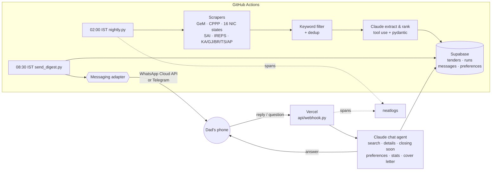
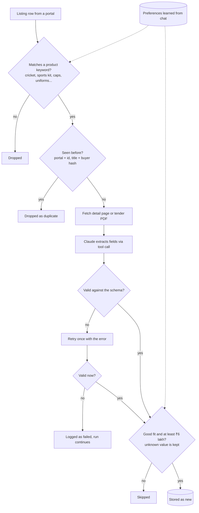
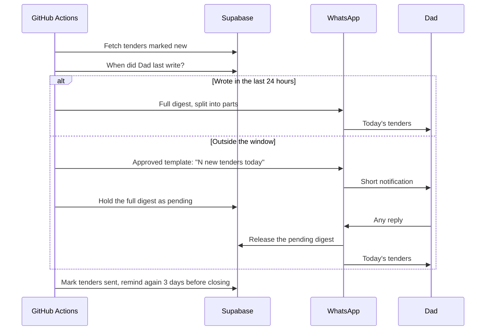
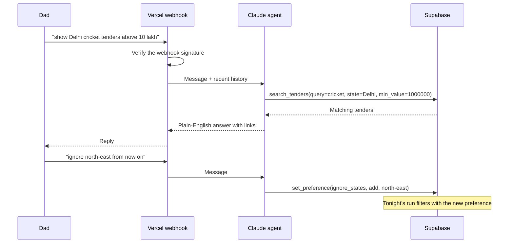

# Tender Bhai 🏏

An AI agent that does business development for my family's export company while everyone sleeps.

**M.J. International** (Meerut, cricket and sports goods) sells to government buyers, but those tenders are scattered across 25+ Indian procurement portals, most of them slow, CAPTCHA-gated or geo-blocked. Nobody had time to check them daily, so bids were missed.

Every night Tender Bhai scrapes the portals, has Claude extract and rank every relevant tender, and stores them. Every morning it sends one WhatsApp digest: who needs what, the value, the deadline, the link. My dad replies in plain English ("details on 2", "what closes this week", "ignore north-east") and the agent answers from the database and remembers his preferences for the next night's run.

| | |
|---|---|
| Portals covered | 25 scrapers: GeM, CPPP, 16 NIC state portals, SAI, IREPS, Karnataka, Telangana, Andhra Pradesh, Bihar, Gujarat |
| Agent tools | 6: search, tender details, closing soon, set preference, weekly stats, draft bid cover letter |
| Tests | 80, run on every push, most against real saved portal pages |
| Always-on infra | none: GitHub Actions cron, a Vercel function, Supabase |
| Running cost | about ₹1,500–2,000 / month, mostly Claude tokens |

> This is a public snapshot of a private repo that runs in production. Personal details (the recipient's phone number, project ids) are replaced with placeholders.

## Sample digest

This is what lands on WhatsApp each morning. It was generated by the real `build_digest` formatter from two real tenders in the portal pages saved on 30 Oct 2026 (`tests/fixtures`). Those pages held 79 listings; 18 matched a product keyword, and most of those (hostel repairs, mess supplies) are the kind the Claude ranking step marks as a skip. The fit labels here were written by hand to show that step, since the sample was built without an API call.

```
🏏 *Tender Bhai — Fri, 30 Oct 2026*
2 new tenders worth a look:

*1. Sports Authority of India*
📦 Taekwondo training equipment
💰 value not stated
⏰ Closes: 06 Nov 2026, 6:00 PM (7 days)
🔗 https://eprocure.gov.in/eprocure/app?component=%24DirectLink&page=FrontEndViewTender&service=direct&session=T&sp=S2uqB9Fq95fU1570vzwPd1Q%3D%3D
🟡 possible — Training equipment, outside cricket but within the sports range

*2. Sports Authority of India*
📦 Sports apparel (MMF blended)
💰 value not stated
⏰ Closes: 12 Nov 2026, 11:59 PM (13 days)
🔗 https://sportsauthorityofindia.nic.in/sai_new/public/assets/uploads/tenders/36dd7286-542d-49f2-907f-4e4f2d55b5c4.pdf
🟢 strong — Sports apparel for Khelo India Games, a core product line

_Ask me anything — e.g. 'details on 2', 'what closes this week', 'show Delhi tenders'_

```

## Architecture



**Flow of one tender:** listing row → keyword match → not seen before (portal+id, title+buyer
hash) → detail page / PDF text → `record_tender` tool call → pydantic validation (one retry) →
skip if `fit=skip` or value below ₹6 lakh (unknown values are kept and shown as
"value not stated") → stored with `status=new` → included in the next morning's digest →
`status=sent`, and reminded again when it closes within 3 days.

## Workflows

### 1. Nightly sourcing (02:00 IST)

Every portal runs in parallel with its own timeout, so one broken portal never stops the rest. Each tender goes through this funnel:



### 2. Morning digest (08:30 IST)

WhatsApp only allows free-form messages within 24 hours of the user's last message, so delivery adapts:



### 3. Chat agent (any time)



### What I'd point out

- **Honest failure states.** A portal that is geo-blocked, OTP-gated or CAPTCHA-gated is reported as `blocked`, not silently empty, and Dad can ask "how did it go this week" to see which portals failed.
- **The model only does the fuzzy part.** Scraping, dedup, filtering and delivery are plain code with tests. Claude reads messy tender PDFs and answers questions, behind a schema check.
- **Feedback loop.** Preferences set in chat change what the next night's run keeps.
- **Observable.** Every run, scraper, extraction and chat turn is traced in [neatlogs](https://neatlogs.com).

## 10-minute setup

### You (one-time)

1. **Supabase** – create a project → SQL Editor → run [`supabase/schema.sql`](supabase/schema.sql).
   Copy *Project URL* and the **service_role** key (Settings → API).
2. **Anthropic** – create an API key at console.anthropic.com.
3. **neatlogs** (optional) – create a project, copy the API key. Without it tracing is a no-op.
4. **Messaging** – either finish the Meta setup below, or use the Telegram fallback while Meta
   reviews the business account.
5. **Vercel** – `vercel link` in this folder (or import the GitHub repo), add the env vars from the
   checklist below, deploy. Your webhook URL is `https://<project>.vercel.app/api/webhook`.
6. **GitHub** – push, add the secrets/variables from the checklist, run the workflow once by hand
   (Actions → nightly → Run workflow → dry run = true) and read the log.
7. Point Meta (or Telegram) at the webhook URL and send a test message.

### Dad (zero setup)

Save the business WhatsApp number in contacts. Every morning a message arrives. Reply to it
like you'd talk to a colleague:

- "details on 2" – everything about tender 2 in today's list, with the link and the deadline
- "what closes this week" / "anything closing in 3 days"
- "show Delhi tenders", "cricket tenders above 20 lakh"
- "ignore north-east", "only above 10 lakh", "also look for football" – remembered from then on
- "draft a cover letter for 1, our turnover is 4 crore"
- "how did it go this week" – counts and which portals failed

## Meta WhatsApp Cloud API setup

1. developers.facebook.com → **Create App** → type *Business* → add the **WhatsApp** product.
2. WhatsApp → **API Setup**: note the *Phone number ID* (`META_PHONE_NUMBER_ID`). Under *To*,
   add and verify the recipient's number as a recipient (test numbers are limited to 5 until the
   business is verified).
3. **Permanent token**: Business Settings → Users → **System Users** → Add (admin) → *Add Assets*
   → your app (full control) → **Generate New Token** with `whatsapp_business_messaging` and
   `whatsapp_business_management`, expiry *Never*. That is `META_ACCESS_TOKEN`.
4. App Settings → Basic → **App Secret** → `META_APP_SECRET` (used to check
   `X-Hub-Signature-256` on every webhook call).
5. WhatsApp → **Message Templates** → Create → category **Utility**, name `daily_tenders`,
   language English, body exactly:

   ```
   Good morning! Tender Bhai found {{1}} new government tenders for M.J. International today. Reply with any message to receive the full list.
   ```

   Sample value for `{{1}}`: `4`. Submit; approval normally takes minutes to a few hours. The
   code sends this template whenever Dad has not written in the last 24 hours (WhatsApp's
   customer-service window) and releases the full digest as soon as he replies.
6. WhatsApp → **Configuration** → Webhook → *Edit*: callback URL
   `https://<project>.vercel.app/api/webhook`, verify token = your `META_VERIFY_TOKEN` → Verify
   and save. Then **Manage** → subscribe to **messages**.
7. Send "hi" from Dad's phone; the Vercel function logs should show `handled=answered`.

## Telegram fallback (until Meta approves)

1. Talk to **@BotFather** → `/newbot` → copy the token → `TELEGRAM_BOT_TOKEN`.
2. Dad (or you, for testing) sends the bot any message, then open
   `https://api.telegram.org/bot<token>/getUpdates` and copy `message.chat.id` →
   `TELEGRAM_CHAT_ID`.
3. Choose a long random `TELEGRAM_WEBHOOK_SECRET` and register the webhook:

   ```bash
   curl "https://api.telegram.org/bot<token>/setWebhook?url=https://<project>.vercel.app/api/webhook/telegram/<secret>"
   ```

4. Set `MESSAGING_PROVIDER=telegram` on Vercel and in the GitHub variables. Switch to
   `whatsapp` later; nothing else changes. Dad never needs to know Telegram exists.

Or run the one-shot finisher once you have the token and chat id (it sets GitHub secrets, Vercel
env vars, registers the webhook, triggers the nightly run and the digest):

```bash
scripts/go_live_telegram.sh <bot_token> <chat_id> <anthropic_api_key>
```

## Supabase

Run `supabase/schema.sql` once (idempotent). Tables: `tenders`, `runs`, `messages`,
`preferences`. RLS is enabled, so only the service key can read anything. See
[`supabase/MIGRATIONS.md`](supabase/MIGRATIONS.md) for conventions and the preference keys.

## Secrets & variables checklist

| Name | Where | Notes |
|---|---|---|
| `ANTHROPIC_API_KEY` | GitHub secret, Vercel | |
| `CLAUDE_MODEL` | GitHub var, Vercel (optional) | default `claude-sonnet-4-5` |
| `SUPABASE_URL` | GitHub secret, Vercel | `https://xxxx.supabase.co` |
| `SUPABASE_SERVICE_KEY` | GitHub secret, Vercel | service_role key |
| `NEATLOGS_API_KEY` | GitHub secret, Vercel | optional |
| `MESSAGING_PROVIDER` | GitHub var, Vercel | `whatsapp` or `telegram` |
| `META_ACCESS_TOKEN` | GitHub secret, Vercel | permanent System User token |
| `META_PHONE_NUMBER_ID` | GitHub secret, Vercel | |
| `META_APP_SECRET` | Vercel | webhook signature |
| `META_VERIFY_TOKEN` | Vercel | your random string |
| `TELEGRAM_BOT_TOKEN` | GitHub secret, Vercel | fallback |
| `TELEGRAM_CHAT_ID` | GitHub secret, Vercel | fallback |
| `TELEGRAM_WEBHOOK_SECRET` | Vercel | fallback |
| `RECIPIENT_PHONE` | GitHub var, Vercel | `91XXXXXXXXXX` |
| `SCRAPER_PROXY_URL` | GitHub secret (optional) | Indian HTTP(S) proxy for GeM, see troubleshooting |
| `META_WABA_ID` | GitHub secret, Vercel (optional) | WhatsApp Business Account id, kept for the Meta go-live |

GitHub: repo → Settings → Secrets and variables → Actions. Vercel: project → Settings →
Environment Variables. `.env.example` lists every variable with comments.

## Running locally

```bash
python3.12 -m venv .venv && source .venv/bin/activate
pip install -r requirements-dev.txt && python -m playwright install chromium
cp .env.example .env   # fill in what you have; Supabase/Anthropic may stay blank for a dry run
```

```bash
python scripts/nightly.py --dry-run                 # scrape + extract, print the digest, store nothing
```

```bash
python scripts/nightly.py --dry-run --no-llm --portals nic_up,sai   # scrape only, two portals
```

```bash
python scripts/send_digest.py --dry-run             # format what would be sent this morning
```

```bash
uvicorn api.webhook:app --reload --port 8000        # webhook locally (pair with `vercel dev` or ngrok)
```

```bash
pytest -q && ruff check . && ruff format --check .
```

Scraper names for `--portals`: `gem`, `cppp`, `sai`, `ireps`, `nic_up`, `nic_delhi`,
`nic_haryana`, `nic_punjab`, `nic_maharashtra`, `nic_rajasthan`, `nic_mp`, `nic_uttarakhand`,
`nic_wb`, `nic_tn`, `nic_odisha`, `nic_hp`, `nic_jk`, `nic_assam`, `nic_jharkhand`,
`nic_chhattisgarh`, `karnataka`, `telangana`, `andhra_pradesh`, `bihar`, `gujarat_nprocure`.

## Schedule

`.github/workflows/nightly.yml`: cron `30 20 * * *` (02:00 IST) runs `scripts/nightly.py` with
Playwright installed; cron `0 3 * * *` (08:30 IST) runs `scripts/send_digest.py`. `workflow_dispatch`
lets you run either job by hand, optionally as a dry run or for selected portals.
`.github/workflows/ci.yml` runs ruff + pytest on every push.

Vercel installs the root `requirements.txt` (which only pulls in `requirements-vercel.txt`) and reads
the Python version from `.python-version`; the scraping worker installs `requirements-worker.txt`.

## Cost estimate (per month)

| Item | Estimate |
|---|---|
| Claude Sonnet 4.5 extraction: ~40 candidates/night × ~8k input + 600 output tokens | ≈ ₹1,100 (≈ $13) |
| Chat: ~20 questions/day × 2 calls × ~3k tokens | ≈ ₹400 (≈ $5) |
| GitHub Actions: ~40 min/night on the free 2,000 min/month | free for a public repo; ≈ 1,200 min on a private repo (within the free tier) |
| Vercel Hobby, Supabase Free | ₹0 |
| WhatsApp Cloud API: 1 utility template/day + free-form replies | ≈ ₹0.12 per template message → under ₹10 |
| neatlogs | free tier |

Roughly **₹1,500–2,000 / month** all-in; the extraction cap (`--max-extract`, default 80) bounds
the worst case.

## Troubleshooting per portal

| Portal | Live check (30 Oct 2026) | What the scraper does | If it fails |
|---|---|---|---|
| **GeM** (`gem`) | `*.gem.gov.in` refuses TCP connections from non-Indian IPs (no HTTP at all). Structure verified from the portal's own page JavaScript and a real archived bid PDF. | GET `/all-bids` for the `csrf_bd_gem_nk` token, POST `/all-bids-data` per keyword, 10 bids/page; detail = PDF at `/showbidDocument/<b_id>` parsed with pdfplumber. | Status `blocked` in the run → set `SCRAPER_PROXY_URL` to an Indian HTTP(S) proxy (or self-host the runner in India). The first successful run confirms the JSON keys; if GeM renames them, `parse_docs` is the only place to change. |
| **CPPP** (`cppp`) | "Latest Active Tenders" and "Tenders by Classification" are **image-CAPTCHA search forms**. CAPTCHA-free: *Tenders by Closing Date* (paginated), home page table, *Tenders by Organisation*. Detail pages render; document download is CAPTCHA-gated. | Opens the by-date list, switches to the "closing within 14 days" tab via the Tapestry form POST, pages in the same session, drills into sports/education/police-type organisations, parses detail labels. | "stale session" errors → the portal timed the session out; lower `REQUEST_DELAY_SECONDS` is *not* the fix, rerun instead. Zero rows + "CAPTCHA-gated" → NIC changed the page; check `tests/fixtures/cppp`. |
| **NIC states** (`nic_*`) | 15 portals verified identical (nicgep 1.09.24); same CAPTCHA situation as CPPP. `cgtenders.gov.in` does **not resolve** (NXDOMAIN); `eproc.cgstate.gov.in` resolves but timed out. | Same code as CPPP with `/nicgep/app`. | A single state failing is reported in `runs.errors` and never stops the others. For Chhattisgarh, edit the host in `nic_states.py` when the state publishes a working URL. |
| **SAI** (`sai`) | Verified: one server-rendered table, PDFs only. | Parses `table#site_datatable`, downloads the PDF for extraction. | Empty table → SAI changed their CMS; fixture in `tests/fixtures/sai`. |
| **IREPS** (`ireps`) | **Blocked**: every anonymous search now requires mobile number + OTP + CAPTCHA. | Detects the OTP gate and reports `blocked` instead of failing. | Needs a human-held mobile OTP; not automatable without an account. |
| **Karnataka** (`karnataka`) | Verified: `kppp.karnataka.gov.in` exposes a public JSON search API and a full-view detail API, no CAPTCHA or cookies (`eproc.karnataka.gov.in` is dead). | POSTs the GOODS search (newest first, 50/page) plus one title search per keyword; detail JSON gives EMD, dates, items, contact. | Non-200 from the API → check the request body shape in `kppp_search_body` against the portal's `main.js`. |
| **Telangana** (`telangana`) | Verified: DataTables JSON listing (`TenderDetailsHomeJson.html`, ~2,000 live rows) and the `ViewTender.html` detail page work with only the JSESSIONID cookie. | Pages the JSON 100 rows at a time, parses the positional columns, posts the detail form; found live "gym equipment" tenders during the build. | HTTP 500 on the listing → the portal requires the full hidden-field set; compare `TS_LIST_FIELDS` with `tests/fixtures/telangana/TenderDetailsHomeJson_request_url.txt`. |
| **Andhra Pradesh** (`andhra_pradesh`) | **Blocked**: `tender.apeprocurement.gov.in` times out at TCP level from abroad. Same vendor product as Telangana. | Runs the Telangana scraper against the AP host and reports `blocked` until a run from India confirms it. | Needs `SCRAPER_PROXY_URL` (Indian egress). If the home page has no `CSRFToken` field the structure differs; capture it and adapt `TelanganaScraper`. |
| **Bihar** (`bihar`) | Partial: listing page and REST endpoints identified from the live Angular app, but every `/rest/...` call (even the master-data one) answers HTTP 500 from our client. | Opens the listing page, reads `orgId`, posts `{orgId}` to `getTenderList`; parses the template's `current*` keys if JSON comes back. | Stays `failed` with the 500 recorded until the portal accepts API calls outside its browser session; capture the real XHR from a browser in India and adjust the headers/body. |
| **Gujarat** (`gujarat_nprocure`) | **Blocked**: the legacy `www.nprocure.com` holds 0 tenders and only speaks TLS 1.0/RC4; all departments moved to `tender.nprocure.com`, which times out from abroad. | Probes `tender.nprocure.com` and reports `blocked`/`partial`. | Needs Indian egress; once reachable, save the listing page to `tests/fixtures/nprocure` and extend `NprocureScraper`. |

General: every portal runs under `PORTAL_TIMEOUT_SECONDS` (default 600 s) with 4 portals in
parallel; `blocked` means the portal could not be reached or is gated (geo-block, OTP, CAPTCHA), `partial` means
some pages worked; failures are counted per portal in `runs.portal_counts` and `runs.errors`, and Dad can
ask "how did it go this week" to see them. Most NIC certificates have broken chains, hence
`VERIFY_TLS=false` by default.

## Observability

With `NEATLOGS_API_KEY` set, every entrypoint calls `neatlogs.init(workflow_name="tender-bhai",
instrumentations=["anthropic"])`, wraps the run in a `WORKFLOW` span, each scraper in a `TOOL`
span, extraction in a `CHAIN` span, sending in a `TOOL` span and each chat turn in an `AGENT`
span grouped by `trace(session_id=<phone>)`, then flushes and shuts down. Without the key every
call is a no-op.

## Layout

```
api/webhook.py              Vercel function (FastAPI): Meta verify + POST, Telegram secret path
scripts/nightly.py          scrape → extract → store (--dry-run prints the digest)
scripts/send_digest.py      morning digest with 24h-window handling
tender_bhai/
  config.py obs.py          settings, neatlogs no-op wrapper
  models.py dates.py money.py keywords.py dedup.py pdf.py
  db.py                     PostgREST client (httpx)
  scrapers/                 base, gem, nicgep (CPPP + NIC states), cppp, nic_states, sai, ireps, states
  extract.py                Claude tool-use extraction + ranking
  digest.py delivery.py     formatting, splitting, 24h window + template
  messaging/                base, whatsapp, telegram, factory
  agent/                    prompts, tools, agent loop
  webhook.py pipeline.py
supabase/schema.sql         tables + RLS + default preferences
tests/                      parsers on real fixtures, extraction, dedup, digest, webhook, agent
```
